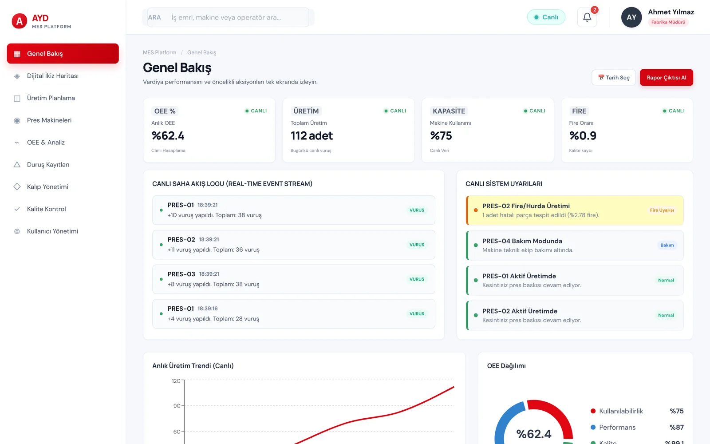
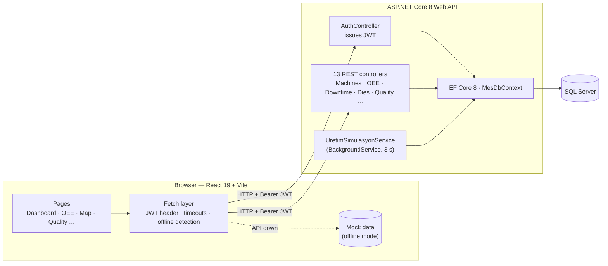

# AYD MES — Manufacturing Execution System

[](https://github.com/dogukanyasaraydin/AydMES/actions/workflows/ci.yml)


**🌐 Live demo:** https://dogukanyasaraydin.github.io/AydMES/ — nothing to install. Pick a role from the *Quick Demo Login* buttons on the sign-in screen.
&nbsp;·&nbsp; 🇹🇷 [Türkçe README](README.md)

AYD MES is a web-based **Manufacturing Execution System** for a press-line factory. It tracks machine telemetry, OEE, downtime, die (mold) life and quality in real time. It consists of a React single-page app, an ASP.NET Core 8 REST API secured with JWT, and a SQL Server database. A background simulation service generates production data as if machines were streaming it live.

> The UI is in Turkish. The domain was modelled on a real automotive press shop.



## ✨ Highlights

- **Real-time monitoring:** machine state, stroke count, temperature and scrap rate, refreshed live at a configurable interval.
- **OEE analytics:** Availability × Performance × Quality, per-machine comparison and production trend charts (Recharts).
- **Digital twin:** factory floor layout in 2D top-down and 3D isometric views, colour-coded by machine status.
- **Production simulation:** a .NET `BackgroundService` adds strokes to running machines every 3 seconds, produces scrap with 4% probability and closes the work order when its target is reached.
- **Role-based access control:** 5 roles (Plant Manager, Quality Engineer, Operator…). Menus and actions are restricted in the UI, and endpoints are restricted by role in the API.
- **Security:** JWT validated for issuer, audience and lifetime. Passwords are hashed with PBKDF2. The signing key lives in configuration, not in source. Every endpoint requires authentication by default (fallback policy).
- **Offline mode:** if the API can't be reached, the UI detects it through timeouts and keeps working with sample data instead of hanging.
- **Reporting:** PDF report export, Excel export, light and dark themes.

## 🏗️ Architecture



## 🛠️ Tech Stack

- **Frontend:** React 19, Vite, Recharts, responsive CSS (light and dark themes)
- **Backend:** C# / .NET 8 Web API, Entity Framework Core 8 (code-first with migrations), JWT Bearer authentication, Swagger/OpenAPI
- **Database:** Microsoft SQL Server
- **CI/CD:** GitHub Actions. Every push builds the backend and lints and builds the frontend. The live demo is deployed to GitHub Pages automatically.

## 📦 Getting Started

**Requirements:** .NET 8 SDK, Node.js 20+, SQL Server (LocalDB is enough)

```bash
dotnet tool install --global dotnet-ef
```
```bash
cd AydMES.Api && dotnet ef database update && dotnet run
```
```bash
cd ayd-mes-ui && npm install && npm run dev
```

The API runs at `http://localhost:5139` (Swagger at `/swagger`) and the UI at `http://localhost:5173`.

**Demo accounts** (seeded on first run, passwords stored hashed): `dogukan / 123` (Software Intern), `ahmet / demo123` (Plant Manager), `ayse / demo123` (Quality Engineer), `mehmet / demo123` (Operator).

In production, provide the JWT signing key via the `Jwt__Key` environment variable (at least 32 characters).

## 🤝 License
Portfolio project. The source is viewable, but the project is not open source. **All rights reserved.** You may not use, copy, redistribute or sell any part of it without permission.

*Developer:* **Doğukan Yaşar Aydın**
