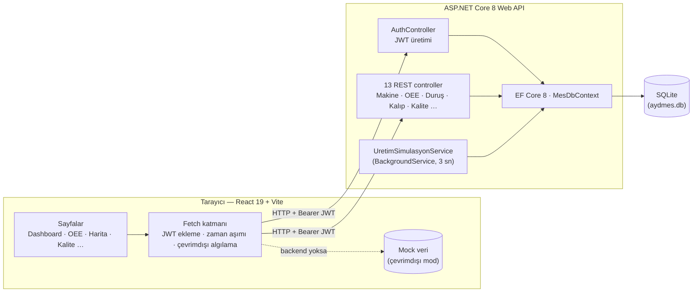

# AYD MES — Üretim Yönetim Sistemi

[](https://github.com/dogukanyasaraydin/AydMES/actions/workflows/ci.yml)


**🌐 Canlı demo:** https://dogukanyasaraydin.github.io/AydMES/ — kurulum gerektirmez. Giriş ekranındaki *Hızlı Demo Girişi* butonlarından bir rol seçin.
&nbsp;·&nbsp; 🇬🇧 [English README](README.en.md)

AYD MES, pres hatları olan bir fabrikada makine telemetrisini, OEE'yi, duruşları, kalıp ömrünü ve kalite süreçlerini gerçek zamanlı izleyen web tabanlı bir **Manufacturing Execution System**'dir. React ile yazılmış tek sayfalık arayüz, JWT ile korunan bir ASP.NET Core 8 REST API'si ve SQLite veritabanından oluşur. Arka planda çalışan bir simülasyon servisi, makinelerden canlı veri geliyormuş gibi üretim verisi üretir.


## ✨ Öne Çıkanlar

| | |
|---|---|
| **Gerçek zamanlı izleme** | Makine durumu, vuruş sayısı, sıcaklık, fire oranı; ayarlanabilir aralıklarla canlı yenilenir. |
| **OEE analizi** | Kullanılabilirlik × Performans × Kalite hesabı, makine karşılaştırma ve üretim trend grafikleri (Recharts). |
| **Dijital ikiz** | Fabrika yerleşimini 2D kuş bakışı ve 3D izometrik görünümde makine durumlarıyla gösterir. |
| **Üretim simülasyonu** | `BackgroundService`, çalışan makinelere 3 saniyede bir vuruş ekler, %4 olasılıkla fire üretir ve hedefe ulaşan iş emrini kapatır. |
| **Rol bazlı yetkilendirme** | 5 rol (Fabrika Müdürü, Kalite Mühendisi, Operatör…). Menüler frontend'de, işlemler API'de rol ile kısıtlanır. Operatör veri okuyabilir ama değiştiremez; GET dışındaki tüm uçlar tek bir kuralla düzenleme yetkisi ister. |
| **Güvenlik** | JWT httpOnly + SameSite=Strict cookie'de taşınır (XSS ile çalınamaz). Şifreler PBKDF2 ile hashlenir. Girişte deneme sınırı vardır (IP başına dakikada 5). Tüm girdiler doğrulanır. Üretimde HTTPS + HSTS açıktır. Depoda hiçbir gizli anahtar bulunmaz. |
| **Otomatik testler** | xUnit entegrasyon testleri (17 test) kimlik doğrulama, rol kısıtlamaları, deneme sınırı, veri doğrulama ve üretim akışını her push'ta CI'da kontrol eder. |
| **Çevrimdışı mod** | Backend'e ulaşılamazsa arayüz zaman aşımıyla bunu algılar ve donmadan örnek verilerle çalışmaya devam eder. |
| **Raporlama** | PDF rapor çıktısı ve Excel'e aktarma; açık/koyu tema. |

## 🖼️ Ekran Görüntüleri

| Giriş | Dijital İkiz Haritası |
|---|---|
|  |  |
| **OEE & Analiz** | **Üretim Planlama** |
|  |  |
| **Pres Makineleri** | **Kalite Kontrol** |
|  |  |

## 🏗️ Mimari



## 🛠️ Teknolojiler

- **Frontend:** React 19, Vite, Recharts, responsive CSS (açık/koyu tema)
- **Backend:** C# / .NET 8 Web API, Entity Framework Core 8 (Code-First, migration'lar), JWT kimlik doğrulama (httpOnly cookie), Rate Limiting, Swagger/OpenAPI
- **Test:** xUnit, `WebApplicationFactory` + bellek içi SQLite ile entegrasyon testleri
- **Veritabanı:** SQLite (EF Core sayesinde SQL Server / PostgreSQL'e tek satırla geçilebilir)
- **CI/CD:** GitHub Actions. Her push'ta backend build, testler ve frontend lint + build çalışır; canlı demo GitHub Pages'e otomatik yayınlanır.

## 📁 Proje Yapısı

```
AydMES.Api/                 ASP.NET Core 8 Web API
├── Controllers/            REST uç noktaları (Auth, MakineVerileri, OeeKayitlari, …)
├── Data/VeriTohumlayici.cs İlk açılışta şema onarımı + örnek veri
├── Migrations/             EF Core migration'ları
├── Models/                 Entity sınıfları ve MesDbContext
├── Security/               JWT/cookie ayarları, şifre hashleme, roller, yazma yetkisi kuralı
└── Services/               Üretim simülasyonu (BackgroundService)
AydMES.Tests/               xUnit entegrasyon testleri (güvenlik ve doğrulama)
ayd-mes-ui/                 React + Vite SPA
├── src/pages/              Dashboard, Analytics, FactoryMap, Production, Quality, …
├── src/components/         Uygulama kabuğu, giriş ekranı, modallar
└── src/utils/              Yetki tablosu, PDF/Excel çıktısı, mock veriler
```

## 📦 Kurulum ve Çalıştırma

**Gereksinimler:** .NET 8 SDK ve Node.js 20+. Ayrı bir veritabanı sunucusu kurmanız **gerekmez**: SQLite veritabanı (`aydmes.db`) ilk çalıştırmada tabloları ve örnek verileriyle birlikte otomatik oluşur.

### 1. Backend
```bash
cd AydMES.Api
dotnet run
```
API `http://localhost:5139` adresinde açılır. Swagger arayüzü `http://localhost:5139/swagger` adresindedir. Swagger'da önce `POST /api/Auth/login` çalıştırın; oturum cookie'si sonraki isteklerde otomatik kullanılır.

### Testler
```bash
dotnet test AydMES.Tests
```
Testler bellekte açılan gerçek bir SQLite veritabanıyla çalışır.

### 2. Frontend
```bash
cd ayd-mes-ui
npm install
npm run dev
```
Uygulama `http://localhost:5173` adresinde açılır.

### Demo hesapları
İlk açılışta otomatik oluşturulur (şifreler hashlenerek saklanır):

| Kullanıcı | Şifre | Rol |
|---|---|---|
| `dogukan` | `123` | Yazılım Stajyeri |
| `ahmet` | `demo123` | Fabrika Müdürü |
| `ayse` | `demo123` | Kalite Mühendisi |
| `mehmet` | `demo123` | Operatör |

Giriş ekranındaki *Hızlı Demo Girişi* butonları backend açıksa bu hesaplarla gerçek JWT girişi yapar. Backend kapalıysa çevrimdışı modda açılır.

## ⚙️ Yapılandırma

| Ayar | Nerede | Açıklama |
|---|---|---|
| `Jwt:Key` | ortam değişkeni `Jwt__Key` | JWT imza anahtarı (en az 32 karakter). Depoda hiçbir anahtar yoktur: geliştirmede tanımlanmazsa API her açılışta rastgele bir anahtar üretir. Üretimde mutlaka ortam değişkeni veya `dotnet user-secrets` ile verin. |
| `ConnectionStrings:DefaultConnection` | `appsettings.json` | SQLite dosya yolu (varsayılan `Data Source=aydmes.db`) |
| `Cors:AllowedOrigins` | `appsettings.json` | Frontend adres(ler)i |
| `VITE_API_URL` | `ayd-mes-ui/.env` | API adresi (varsayılan `http://localhost:5139/api`) |
| `VITE_DEMO_MODE` | derleme ortamı | `true` olursa backend'e hiç istek atılmaz (canlı demo) |

## ⚠️ Sık Karşılaşılan Hatalar

**Veritabanını sıfırlamak istiyorum:** API kapalıyken `AydMES.Api/aydmes.db` dosyasını silin; bir sonraki `dotnet run`'da örnek verilerle yeniden oluşur.

**Girişte "Sunucuya bağlanılamadı":**
- Backend'in (`dotnet run`) çalıştığından emin olun.
- Tarayıcı yerel HTTPS sertifikasını engelliyorsa `ayd-mes-ui/.env` dosyasına `VITE_API_URL=http://localhost:5139/api` satırını ekleyip `npm run dev`'i yeniden başlatın.

**API "Jwt:Key yapılandırılmamış" hatasıyla açılmıyor:** API `Development` dışındaki bir ortamda çalışıyordur. `Jwt__Key` ortam değişkenini tanımlayın ya da `dotnet run` ile (Development) çalıştırın.

**API yeniden başlatılınca oturum düşüyor:** Geliştirmede JWT anahtarı her açılışta yeniden üretildiği için bu normaldir. Tekrar giriş yapmanız yeterli.

## 🤝 İletişim & Telif Hakkı
Bu proje portfolyo amacıyla geliştirilmiş, kaynak kodu görüntülenebilir ama açık kaynak lisanslı olmayan bir projedir. **Tüm hakları saklıdır.** Kaynak kodu, tasarımı veya herhangi bir parçası izinsiz **kullanılamaz, kopyalanamaz, çoğaltılamaz ve ticari amaçla satılamaz.** Yalnızca inceleme (portfolyo) amacıyla görüntülenebilir.

*Geliştirici:* **Doğukan Yaşar Aydın**
